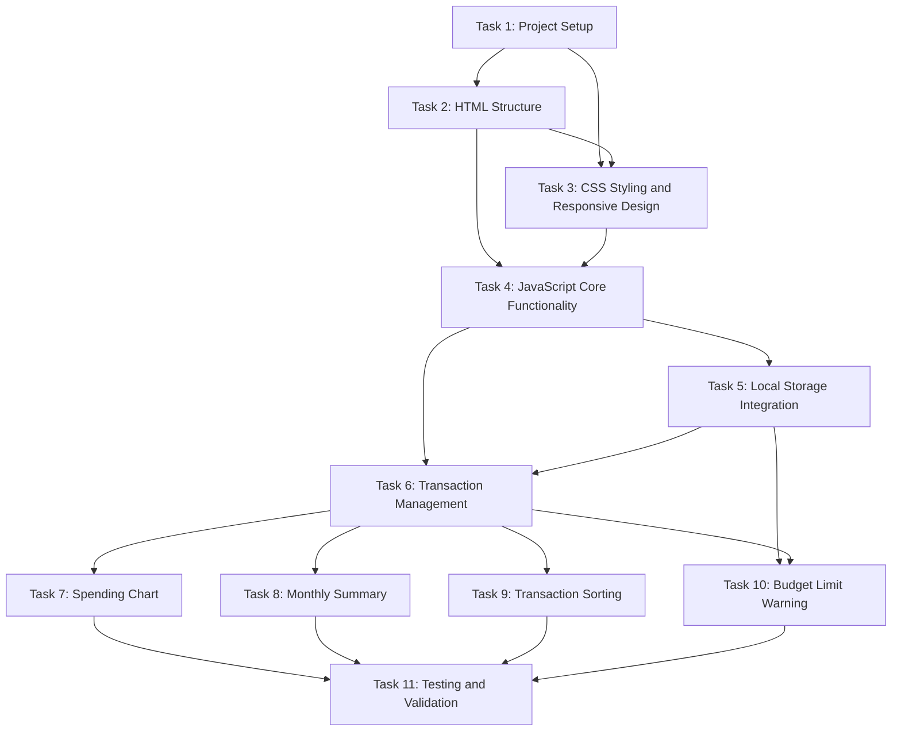

# Implementation Plan

## Overview

The Expense & Budget Visualizer is built as a single-page, client-side web application with no build step and no backend. Implementation proceeds in dependency order: project scaffold first, then the HTML skeleton, then CSS, then JavaScript modules from the bottom up (Storage → Form → Balance → List → Chart → Summary → App), and finally responsive CSS polish and end-to-end validation. Each JavaScript module is self-contained inside one IIFE in `js/script.js`; modules are wired together by `App.init()` and `App.refresh()`.

## Tasks

### 1. Project Setup

- [x] 1.1 Create the `Expense-Budget-Visualizer/` root folder with `css/` and `js/` subfolders.
- [x] 1.2 Create placeholder files: `index.html`, `css/style.css`, `js/script.js`.

### 2. HTML Structure

- [x] 2.1 Add the HTML5 boilerplate to `index.html`: `<!DOCTYPE html>`, `<html lang="en">`, `<head>` (charset, viewport, title), `<body>`.
- [x] 2.2 Link `css/style.css` in `<head>` and load Chart.js from CDN (`<script>` before the closing `</body>`).
- [x] 2.3 Link `js/script.js` after the Chart.js script tag.
- [x] 2.4 Add the sticky `<header>` section with the app name and subtitle.
- [x] 2.5 Add the full-width balance card (`<section id="balance-card">`) with placeholders for total amount, budget limit display, and the warning strip element.
- [x] 2.6 Add the top two-column grid: Add Transaction `<form>` on the left (fields: item name, amount, category select, date, optional budget limit) and the `<canvas id="spending-chart">` on the right.
- [x] 2.7 Add the Transaction List section: sort control buttons and the `<table>` (or container for stacked cards on mobile) with `<thead>` and `<tbody id="transaction-body">`.
- [x] 2.8 Add the Monthly Summary section: `<div id="monthly-summary">` to be populated by JavaScript.
- [x] 2.9 Add the static `<footer>` attribution line.

### 3. CSS Styling and Responsive Design

- [x] 3.1 Define CSS custom properties (variables) for the blue palette: `--blue-900` (#0d2b55) through `--blue-50` (#eff6ff), plus danger red (#ef4444) and neutral grays.
- [x] 3.2 Write a CSS reset and base typography rules: Segoe UI / system-ui stack, weights 400 / 600 / 700 / 800.
- [x] 3.3 Style the sticky header with the gradient background.
- [x] 3.4 Style the balance card: full-width gradient, rounded corners (`border-radius: 12px`), subtle shadow, smooth hover transitions. Add the `.over-limit` variant that switches to the danger red palette and shows the left-border warning strip.
- [x] 3.5 Style the top grid as a two-column CSS Grid layout (form left, chart right).
- [x] 3.6 Style the Add Transaction form: input fields, select, date picker, submit button, inline error message elements (`.error` class).
- [x] 3.7 Style the transaction table: header row, data rows, category badge chips, the Delete button (`white-space: nowrap` so the label never wraps), hover states.
- [x] 3.8 Style the sort control bar: button group, active-sort indicator, horizontal scroll container with hidden scrollbar for overflow on small screens.
- [x] 3.9 Style month cards: grid layout, over-limit red highlight variant.
- [x] 3.10 Style empty-state messages for the transaction list and chart area.
- [x] 3.11 Style the footer.
- [~] 3.12 Add the 768 px responsive breakpoint: single-column layout; transaction table transforms to stacked card list using `data-label` pseudo-labels (`content: attr(data-label)`); sort controls scroll horizontally with scrollbar hidden.
- [~] 3.13 Add the 400 px responsive breakpoint: reduce balance amount font size; collapse monthly summary grid to one column.

### 4. JavaScript Core Functionality

- [~] 4.1 Create the top-level IIFE wrapper in `js/script.js` to encapsulate all modules without polluting the global scope.
- [~] 4.2 Implement the `escapeHtml(str)` utility that escapes `<`, `>`, `&`, `"`, and `'` before any user string is inserted into `innerHTML`.
- [~] 4.3 Implement the `generateId()` utility: `Date.now().toString(36)` concatenated with a random suffix to produce a unique transaction ID.

### 5. Local Storage Integration

- [~] 5.1 Implement `Storage.load()`: reads `ebv_transactions` from `localStorage`, parses JSON, and returns the array. Wraps `JSON.parse` in a try/catch and returns `[]` on failure.
- [~] 5.2 Implement `Storage.save(transactions)`: serialises the array to JSON and writes it to `ebv_transactions`.
- [~] 5.3 Implement `Storage.loadLimit()`: reads `ebv_budget_limit` and returns it as a number, or `null` if absent or non-numeric.
- [~] 5.4 Implement `Storage.saveLimit(value)`: writes the numeric limit as a string to `ebv_budget_limit`.

### 6. Transaction Management

- [~] 6.1 Implement `Form.init()`: registers the submit event listener on the Add Transaction form; on submit, reads and validates all required fields (item name non-empty, amount positive number, category one of Food/Transport/Fun, date present); displays inline error messages and applies the `.error` CSS class for each invalid field; blocks submission if any field is invalid.
- [~] 6.2 Implement the transaction-creation path in `Form`: on valid submission, build the transaction object (`{ id, name, amount, category, date }`), append it to the array from `Storage.load()`, call `Storage.save()`, then call `App.refresh()`.
- [~] 6.3 Implement the budget-limit save path in `Form`: when the optional limit field has a valid numeric value, call `Storage.saveLimit()` on submission; restore the saved limit into the field on `Form.init()`.
- [~] 6.4 Implement field reset in `Form`: after a successful save, clear all required fields back to their default empty / placeholder state.
- [~] 6.5 Implement `Balance.render(transactions, limit)`: sums all `amount` values with `Array.reduce`; compares total to `limit`; toggles the `.over-limit` CSS class on the balance card; shows or hides the warning strip with the left-border accent.
- [~] 6.6 Implement the `List.deleteHandler(id)`: filters the transaction with the matching `id` out of the stored array, calls `Storage.save()`, then calls `App.refresh()`.
- [~] 6.7 Implement `List.render(transactions)`: builds the table rows using `escapeHtml` for all user-supplied strings; each row has a Delete button labelled "Delete" (full word) with the transaction ID in a `data-id` attribute; wires delete buttons to `List.deleteHandler`.

### 7. Spending Chart

- [~] 7.1 Implement `ChartModule.render(transactions)`: aggregates transaction amounts by category (Food, Transport, Fun); if there are no transactions, destroys any existing Chart.js instance and shows the empty-state placeholder.
- [~] 7.2 On first render (or after the chart was destroyed), create a new Chart.js pie chart instance on the `<canvas>` element with the aggregated data.
- [~] 7.3 On subsequent renders with existing data, call `.update()` on the existing Chart.js instance rather than re-creating it, to avoid memory leaks.
- [~] 7.4 Add a `max-height` guard on the chart canvas so it does not overflow its container at any viewport width.

### 8. Monthly Summary

- [~] 8.1 Implement `monthKey(dateString)`: converts an ISO 8601 date string to a local-timezone `Date` object and returns a `"YYYY-MM"` key using `getFullYear()` and `getMonth()` (not string slicing) to ensure correct timezone grouping.
- [~] 8.2 Implement `Summary.render(transactions, limit)`: groups transactions by `monthKey`; for each group, computes total spend and transaction count; sorts groups newest-first; renders one month card per group showing the month name, total spend, and count.
- [~] 8.3 Apply the over-limit highlight to any month card whose total spend equals or exceeds the applicable budget limit. Use the per-month user-configured limit if one is set; otherwise use the global budget limit.

### 9. Transaction Sorting

- [~] 9.1 Implement the sort state machine in `List`: maintain a `currentSort` variable (default: `"date-desc"`). The available sort keys are: `"date-desc"` (newest first), `"amount-desc"`, `"amount-asc"`, `"category-asc"` (A to Z).
- [~] 9.2 Wire each sort button to update `currentSort` and call `App.refresh()`.
- [~] 9.3 In `List.render`, sort a copy of the transactions array by `currentSort` before rendering rows. Never mutate the source array or write sort state to `localStorage`.
- [~] 9.4 Apply an active-sort CSS class to the currently selected sort button so the user can see which sort is active.

### 10. Budget Limit Warning

- [~] 10.1 In `Balance.render`, treat total spending equal to the budget limit as exceeding it: the `.over-limit` state triggers when `total >= limit`.
- [~] 10.2 Ensure the warning strip has a visible left-border accent (distinct border-left colour) in addition to the red background.
- [~] 10.3 When no budget limit is stored (`Storage.loadLimit()` returns `null`), render the balance card in its normal blue gradient state with no warning.
- [~] 10.4 In `Summary.render`, apply the same `>= limit` threshold for month-card highlighting.

### 11. Testing and Validation

- [~] 11.1 Open `index.html` directly in a browser (no server) and verify the page loads without console errors.
- [~] 11.2 Add at least one transaction for each category (Food, Transport, Fun) and confirm: the balance card total updates, the pie chart shows three segments, the transaction list shows all rows, and the monthly summary shows a card.
- [~] 11.3 Verify inline validation: submit the form with each required field empty in turn and confirm the correct error message appears and no transaction is saved.
- [~] 11.4 Set a budget limit below the current total and confirm the balance card turns red with the left-border warning strip.
- [~] 11.5 Set a budget limit equal to the current total and confirm the balance card shows the over-limit (red) state.
- [~] 11.6 Delete a transaction and confirm: the balance card recalculates, the pie chart updates, and the monthly summary updates.
- [~] 11.7 Verify sort controls: test each of the four sort options and confirm the list re-orders correctly without altering `localStorage`.
- [~] 11.8 Add transactions across two different calendar months and confirm the monthly summary shows two separate cards sorted newest-first.
- [~] 11.9 Reload the page and confirm all transactions and the budget limit are restored from `localStorage`.
- [~] 11.10 Corrupt `ebv_transactions` in DevTools (`localStorage.setItem("ebv_transactions", "bad json")`) and reload; confirm the app starts with an empty list and does not crash.
- [~] 11.11 Resize the viewport to 768 px and below; confirm the single-column layout, stacked card table, and horizontal sort scroll all render correctly.
- [~] 11.12 Resize the viewport to 400 px and below; confirm the balance amount font is smaller and the monthly grid collapses to one column.

## Task Dependency Graph



```json
{
  "waves": [
    {
      "wave": 1,
      "tasks": ["1"]
    },
    {
      "wave": 2,
      "tasks": ["2"]
    },
    {
      "wave": 3,
      "tasks": ["3", "4"]
    },
    {
      "wave": 4,
      "tasks": ["5"]
    },
    {
      "wave": 5,
      "tasks": ["6"]
    },
    {
      "wave": 6,
      "tasks": ["7", "8", "9", "10"]
    },
    {
      "wave": 7,
      "tasks": ["11"]
    }
  ]
}
```

**Key ordering constraints:**

- Task 1 (Project Setup) must complete before Task 2 (HTML Structure) and Task 3 (CSS Styling), because the folder and file placeholders must exist before either can be written.
- Task 2 (HTML Structure) must complete before Task 3 (CSS Styling) and Task 4 (JavaScript Core Functionality), because CSS selectors and JavaScript DOM queries depend on the HTML elements existing.
- Task 3 (CSS Styling) and Task 4 (JavaScript Core Functionality) must both complete before any further JavaScript work, because the IIFE scaffold and CSS class names are prerequisites for all modules.
- Task 4 (JavaScript Core Functionality) must complete before Task 5 (Local Storage Integration) and Task 6 (Transaction Management), because the IIFE wrapper and utility functions are shared by all modules.
- Task 5 (Local Storage Integration) must complete before Task 6 (Transaction Management), because the Form, Balance, and List modules all call `Storage.load()` and `Storage.save()`.
- Task 6 (Transaction Management) must complete before Tasks 7 (Spending Chart), 8 (Monthly Summary), and 9 (Transaction Sorting), because those modules consume the transactions array and the `App.refresh()` orchestration established in Task 6.
- Task 5 (Local Storage Integration) and Task 6 (Transaction Management) must both complete before Task 10 (Budget Limit Warning), because the warning logic reads the limit from Storage and applies it inside the Balance and Summary modules.
- Tasks 7, 8, 9, and 10 can be developed in parallel once Task 6 is complete, as they have no dependency on each other.
- Task 11 (Testing and Validation) requires every preceding task to be complete, because the validation steps exercise the fully integrated application end-to-end.

## Notes

- All application data is stored in browser Local Storage.
- No backend server is required.
- Chart.js is loaded through CDN.
- The application uses HTML, CSS, and Vanilla JavaScript.
- Only one CSS file and one JavaScript file are permitted.